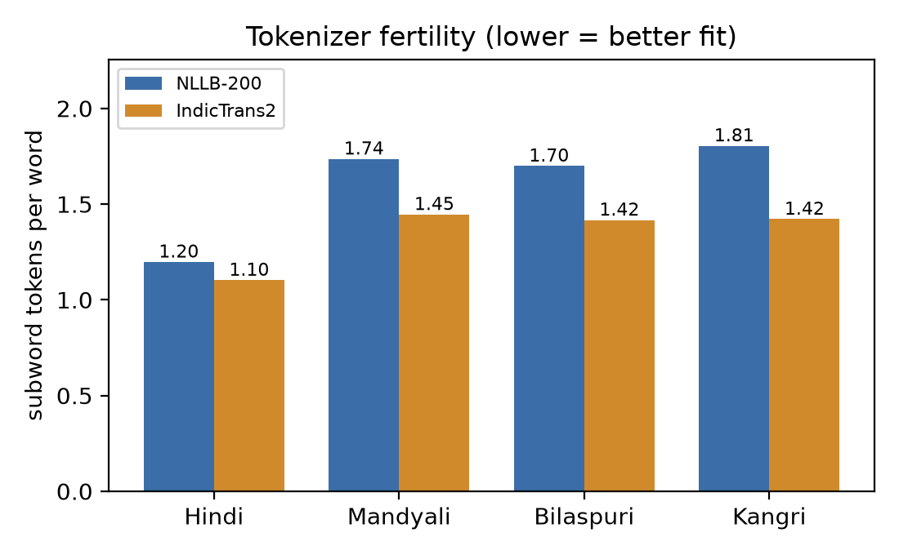
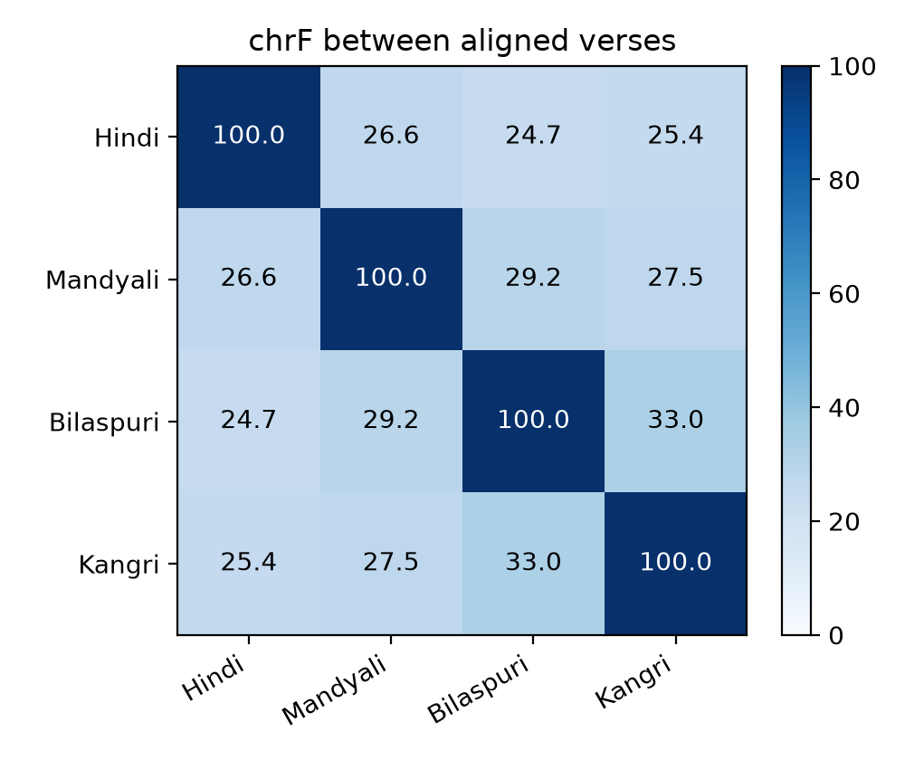
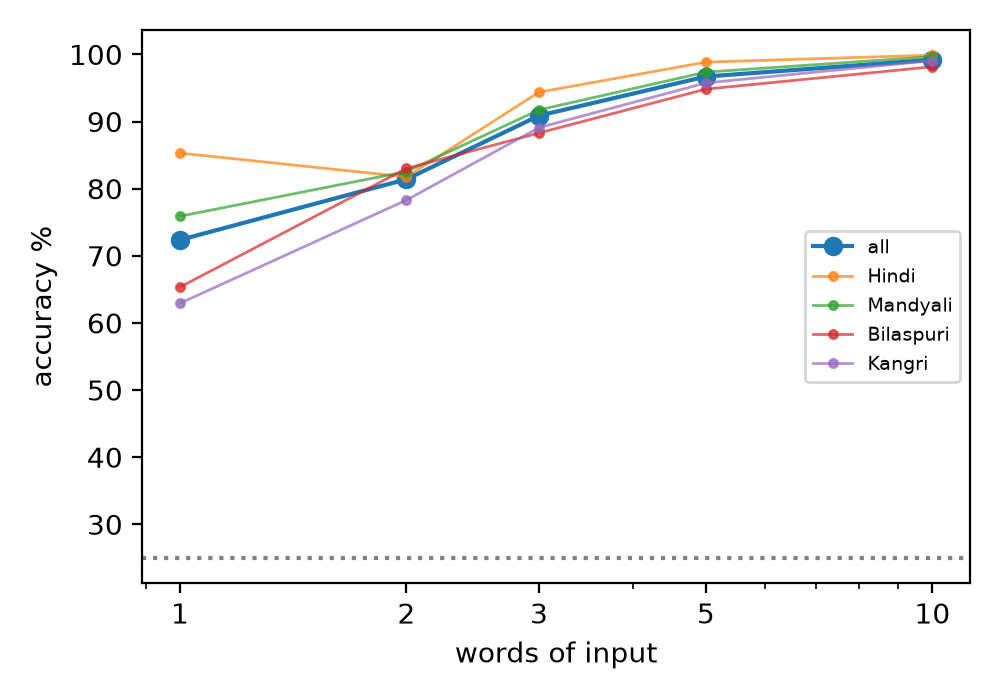
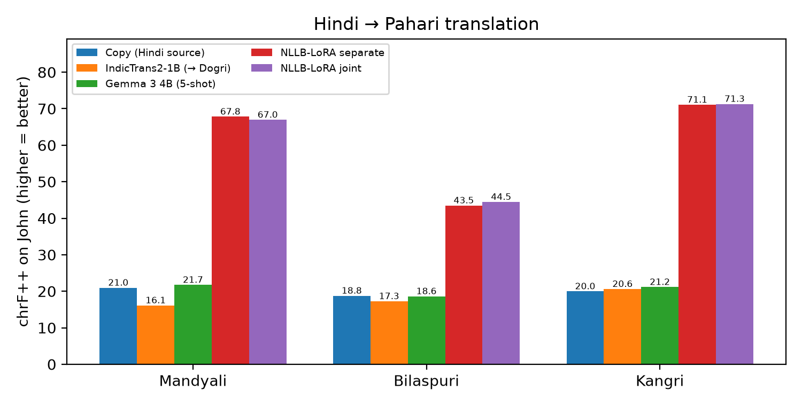
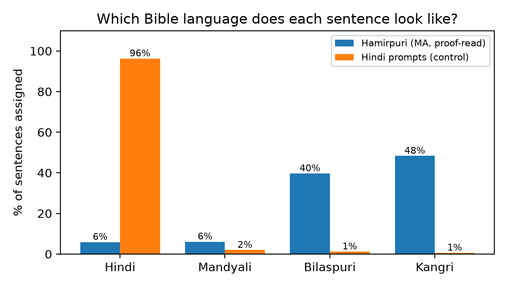
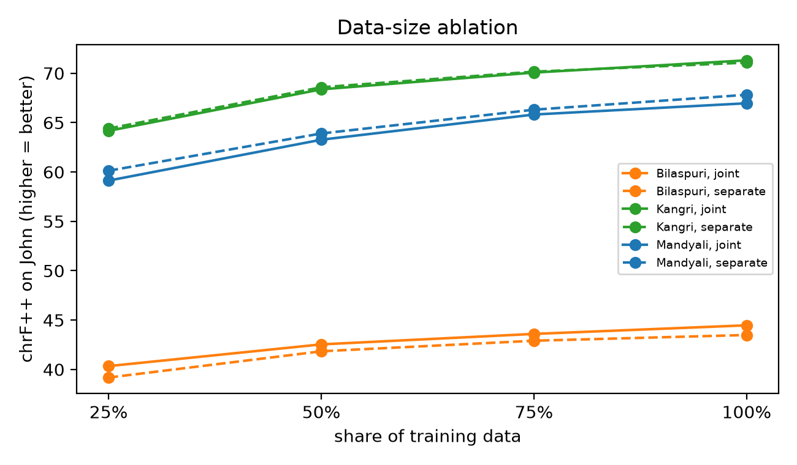

# Project 1 results (Bible data)

Reproduce:

```bash
uv run python src/data.py && uv run python src/analysis.py && uv run python src/dialect_id.py && uv run python src/stats.py
```

`data/` (clean TSV) is git-ignored, like the xlsx sources. Everything here is regenerated by the scripts.

## Data cleaning (`src/data.py`, 2026-10-11)

Full log: [data_report.txt](data_report.txt).

| Step | Verses |
|---|---|
| Raw sheet | 7,567 |
| Empty cell (HEB.12.1, MAT.5.4, REV.2.8) | −3 |
| Other verses pasted into one cell (13 rows, mostly LUK) | −13 |
| Cell under 2 words (REV.12.18 Mandyali was just a danda) | −1 |
| Misaligned cell (text matches a neighbouring verse better than its own row) | −204 |
| **Kept** | **7,346**: train 6,045 · dev (ROM) 430 · test (JHN) 871 |

Fixes applied to the text: Unicode NFC; Mandyali's Latin `l` used as a sentence end replaced by
`।` (otherwise the dialect classifier could cheat on it); Hindi cross-references such as
`(उत्प. 19:26)` removed (the Pahari texts don't have them); zero-width and soft-hyphen chars removed.

Misalignment: most of it is Bilaspuri **1 Corinthians chapters 3–6 and 15–16**, where the text is
shifted against the verse numbers (175 kfs verses; any chapter with ≥ 25% flagged verses is
dropped whole). Others are scattered (mjl 29, xnr 9, hin 2). Some may be false positives (repeated
or merged verses); dropping them costs little.

## Dataset statistics (`src/stats.py`, 2026-10-13)

All 7,346 clean verses ([csv](stats/dataset_stats.csv)). OOV = word not seen in the train books.

| | Hindi | Mandyali | Bilaspuri | Kangri |
|---|---|---|---|---|
| Word tokens | 169,305 | 180,688 | 186,210 | 173,439 |
| Word types | 6,292 | 8,768 | 12,909 | 9,167 |
| Type/token ratio % | 3.72 | 4.85 | 6.93 | 5.29 |
| Hapax (seen once) % of types | 34.8 | 44.7 | 48.8 | 46.8 |
| Words/verse (mean / median) | 23.1 / 22 | 24.6 / 23 | 25.4 / 24 | 23.6 / 22 |
| Characters/word | 3.62 | 3.89 | 3.89 | 4.00 |
| **Test (JHN) OOV % of tokens** | 1.29 | 3.30 | **5.37** | 2.62 |
| Test (JHN) OOV % of types | 10.9 | 22.0 | 27.4 | 20.4 |

What it says:
1. The Pahari texts have **40–105% more distinct words than Hindi** for the same verses, and more
   one-off words: richer inflection and **less standardised spelling** (one word, several spellings).
2. **Bilaspuri is the hardest**: largest vocabulary and the highest unseen-word rate on the test
   book (5.4% of tokens vs 1.3% for Hindi). Expect its MT scores to be lowest.

## Tokenizer fertility (`src/stats.py`)

How each model's tokenizer cuts words into subword pieces ([csv](stats/fertility.csv)).
NLLB-200 is the Part D model; IndicTrans2 (Indic/target side, `model.TGT` of
`indictrans2-en-indic-dist-200M`, raw SentencePiece, no IndicProcessor normalisation) is a Part C baseline.

| | Hindi | Mandyali | Bilaspuri | Kangri |
|---|---|---|---|---|
| NLLB-200: pieces per word | **1.20** | 1.74 | 1.70 | 1.81 |
| NLLB-200: % words kept whole | **85.2** | 46.4 | 51.0 | 45.5 |
| NLLB-200: % words in 3+ pieces | 4.0 | 17.2 | 17.8 | 21.1 |
| NLLB-200: % words with unknown token | 0.0 | 0.0 | **0.5** | 0.0 |
| IndicTrans2: pieces per word | **1.10** | 1.45 | 1.42 | 1.42 |
| IndicTrans2: % words kept whole | **91.6** | 63.3 | 66.2 | 65.1 |
| IndicTrans2: % words in 3+ pieces | 1.6 | 7.1 | 7.4 | 6.5 |
| IndicTrans2: % words with unknown token | 0.0 | 0.01 | 0.0 | 0.0 |



What it says:
1. Both tokenizers keep most Hindi words whole but cut **a third (IndicTrans2) to a half (NLLB)
   of Pahari words** into pieces (+29–51% pieces per word vs Hindi). The models "see" these
   languages as broken-up Hindi-like text, one reason zero-shot translation should be weak.
2. IndicTrans2's Indic vocabulary fits Pahari better than NLLB's (1.42–1.45 vs 1.70–1.81).
3. All NLLB unknown tokens in Bilaspuri come from one letter, **`ऴ` (U+0934, retroflex ḷ)**,
   928 times; NLLB's vocabulary lacks it, so the model can never output it. IndicTrans2 has it.
   Part D must map `ऴ` → `ळ` (and back for display) or add the character to NLLB's vocabulary.

## Part A: similarity (`src/analysis.py`)

**chrF between aligned verses** (0–100, higher = more shared character sequences; mean of both directions):

| | Hindi | Mandyali | Bilaspuri | Kangri |
|---|---|---|---|---|
| Hindi | – | 26.6 | 24.7 | 25.4 |
| Mandyali | 26.6 | – | 29.2 | 27.5 |
| Bilaspuri | 24.7 | 29.2 | – | **33.0** |
| Kangri | 25.4 | 27.5 | **33.0** | – |



**% of the column language's word tokens whose word also occurs in the row language** ([csv](analysis/shared_vocab.csv)):

| vocab of ↓ covers tokens of → | Hindi | Mandyali | Bilaspuri | Kangri |
|---|---|---|---|---|
| Hindi | – | 34.3 | 28.6 | 27.3 |
| Mandyali | 56.1 | – | 53.2 | 42.7 |
| Bilaspuri | 62.0 | 68.3 | – | 71.3 |
| Kangri | 45.8 | 49.4 | 57.7 | – |

Vocabulary sizes (word types): Hindi 6,292 · Mandyali 8,768 · Kangri 9,167 · Bilaspuri 12,909.

**Typical words vs Hindi** (weighted log-odds, [full list](analysis/typical_words.md)), top 10:
- Mandyali: होर किन्हें रे मन्झ ले तेस री कठे ता तुस्सा
- Bilaspuri: सै जे कने भई रे च नीं खातर ते रा
- Kangri: कने ऐ नैं दे सैह दा च तुहां हन ते

What it says:
1. **Bilaspuri and Kangri are the closest pair** (chrF 33.0; Bilaspuri's vocabulary covers 71% of
   Kangri tokens). Mandyali sits a little apart. All three Pahari varieties are closer to each
   other than to Hindi, but only by a few points.
2. **Hindi is about equally far from all three** (chrF 24.7–26.6). Copying the Hindi source will
   be a weak translation baseline.
3. The absolute chrF values are low for all pairs, because each Bible is an **independent free
   translation**, not a word-for-word one. So these numbers mix "language distance" with
   "translator style". Treat them as relative, not absolute.
4. Hindi's vocabulary covers only 27–34% of Pahari tokens: the function words differ (genitive
   री/रे in Mandyali and Bilaspuri vs दा/दे in Kangri vs का/के in Hindi; "and": होर / कने; "in": मन्झ / च).
5. Coverage numbers are skewed by vocabulary size (Bilaspuri has the largest vocabulary, so it
   "covers" everyone best). Read the table with that in mind.

## Part B: dialect identifier (`src/dialect_id.py`)

Char 1–4-gram TF-IDF (`char_wb`) + logistic regression; trained on 6,045 × 4 train verses;
C chosen on dev 3-word snippets (C = 10); tested once on John (871 × 4).

| Input | Accuracy % | Hindi | Mandyali | Bilaspuri | Kangri |
|---|---|---|---|---|---|
| Full verse | **99.86** | 100.00 | 100.00 | 99.54 | 99.89 |
| First 1 word | 72.36 | 85.30 | 75.89 | 65.33 | 62.92 |
| First 2 words | 81.40 | 81.75 | 82.55 | 83.01 | 78.30 |
| First 3 words | 90.87 | 94.37 | 91.73 | 88.29 | 89.09 |
| First 5 words | 96.70 | 98.85 | 97.36 | 94.83 | 95.75 |
| First 10 words | 99.20 | 99.89 | 99.66 | 98.16 | 99.08 |

Chance = 25%.



Confusions at 3 words ([png](dialect_id/confusion_3w.png)): the biggest error is
**Kangri → Bilaspuri (69 of 871)**, then Bilaspuri → Kangri (51), matching Part A
(Bilaspuri–Kangri closest). Hindi is rarely confused with anything except Bilaspuri (33).

What it says:
1. A simple classifier separates the four varieties almost perfectly on full verses, and
   needs only about 5 words for ~97%.
2. **Caveat:** each language here is one Bible translation by one team. The classifier may
   partly learn **spelling conventions** of that translation (e.g. यीसू vs यीशु, परमेसर vs परमेशर),
   not only the dialect. The real test is Hamirpuri/Bilaspuri text from other speakers (Project 2).

## Part C: translation baselines (`src/run_indictrans2.py`, `src/run_gemma.py`, `src/evaluate.py`, 2026-10-14)

Hindi → each Pahari language on the test book, John (871 verses). Scores from sacrebleu
([signatures](scores/signatures.txt)): **chrF++** (main) and **spBLEU** (BLEU with the
FLORES-200 SentencePiece tokenizer). "chrF++ vs Hindi" scores the output against the Hindi
*source*: 100 = pure copy; high = the system stayed close to Hindi.

| System | Language | chrF++ | spBLEU | chrF++ vs Hindi | aborted |
|---|---|---|---|---|---|
| Copy (Hindi source) | Mandyali | 20.96 | 2.79 | 100.00 | – |
| Copy (Hindi source) | Bilaspuri | 18.77 | 3.12 | 100.00 | – |
| Copy (Hindi source) | Kangri | 19.97 | 3.43 | 100.00 | – |
| IndicTrans2-1B (→ Dogri) | Mandyali | 16.13 | 1.45 | 19.62 | – |
| IndicTrans2-1B (→ Dogri) | Bilaspuri | 17.27 | 1.84 | 19.62 | – |
| IndicTrans2-1B (→ Dogri) | Kangri | 20.61 | 5.30 | 19.62 | – |
| Gemma 3 4B (5-shot) | Mandyali | **21.75** | 5.53 | 40.06 | 0 |
| Gemma 3 4B (5-shot) | Bilaspuri | 18.62 | 3.92 | 34.62 | 2 |
| Gemma 3 4B (5-shot) | Kangri | **21.15** | **6.12** | 39.58 | 12 |



Setup:
- **Copy**: the Hindi verse unchanged.
- **IndicTrans2-1B** (`ai4bharat/indictrans2-indic-indic-1B`), Hindi → Dogri (`doi_Deva`, the
  closest supported Pahari language), beam 5, fp16. One Dogri output scored against all three
  references. Runs in `.venv-it2` (transformers 4.46.3); IndicProcessor's Devanagari steps
  re-implemented with indic-nlp-library because IndicTransToolkit needs a C++ compiler on Windows.
- **Gemma 3 4B** (`gemma3:4b`, Ollama 0.40.3), chat format with 5 fixed example pairs per language
  ([shots](baselines/gemma_mjl_shots.json)), temperature 0, seed 0. "Aborted" = Ollama stopped a
  reply that looped on one character ("token repeat limit reached", e.g. `अपणूंूंूं…`); the partial
  output is kept and scored.

Examples: [scores/examples.md](scores/examples.md).

What it says:
1. **No existing tool really translates into these languages.** The best system beats copying
   the Hindi by at most ~1 chrF++ point (Gemma: +0.8 Mandyali, +1.2 Kangri, −0.2 Bilaspuri).
   These are differences of the size a significance test may not confirm; treat them as ties.
2. **Writing a neighbouring language doesn't help.** IndicTrans2 writes fluent Dogri (chrF++ vs
   Hindi only 19.6), but it scores *below* Copy for Mandyali (−4.8) and Bilaspuri (−1.5) and only
   matches it for Kangri (+0.6), the variety closest to Dogri (Kangri ↔ Dogri vocabulary: `दे/दा`,
   `च`). It also localises names and words differently (यूहन्ना → जॉन, परमेश्वर → भगवान).
3. **Gemma mostly writes Hindi with Pahari words sprinkled in** (35–40 chrF++ vs Hindi): it picks
   up function words from the examples (`होर`, `कने`, `री`, `कांभई`) but keeps Hindi grammar,
   and sometimes uses the wrong variety's word (`होर`, Mandyali "and", in Bilaspuri output). It also
   breaks down on some verses (14 replies looping on one vowel sign, 12 of them Kangri).
4. **Bilaspuri is lowest for every system**, as the dataset statistics predicted (largest
   vocabulary, most unseen words).
5. **All scores are low in absolute terms (≤ 22 chrF++)**, partly because each reference is a
   free translation: even a correct translation that words things differently loses points.
   Scores are comparable between systems, not to scores on other datasets.

This is the bar for Part D: a model fine-tuned on the training books must clearly beat ~21 chrF++.

## Hamirpuri check (`src/hamirpuri_check.py`, 2026-10-15)

The Part B dialect identifier (trained on the Bible train books; knows only Hindi, Mandyali,
Bilaspuri, Kangri) applied to MA's **509 proof-read Hamirpuri sentences** (final = last non-empty
`corrected`, else `text`). Control: the 509 Hindi prompts. Only aggregate numbers are reported.

| Input | n | Hindi | Mandyali | Bilaspuri | Kangri |
|---|---|---|---|---|---|
| Hamirpuri (MA, proof-read) | 509 | 5.9% | 6.1% | 39.7% | **48.3%** |
| Hindi prompts (control) | 509 | **96.3%** | 2.0% | 1.2% | 0.6% |



Stable across batches (Kangri 48.5% batch 1, 48.2% batch 2) and lengths; the longest sentences
(9+ words, n = 48) lean more Kangri (60.4%). Mean classifier confidence is low for every
language (p(Kangri) 0.37, p(Bilaspuri) 0.34): Hamirpuri sits **between** Kangri and Bilaspuri,
not inside either. [by batch/length](hamirpuri_check/by_batch.csv)

**Function words per 1,000 tokens** ([full table](hamirpuri_check/function_words.csv)):

| Word (meaning) | Hamirpuri | Hindi | Mandyali | Bilaspuri | Kangri |
|---|---|---|---|---|---|
| दा / दे / दी ("of") | 12.1 / 11.4 / 12.8 | 0 / 1.3 / 1.3 | 0 / 1.1 / 0 | 0 / 0.5 / 0 | 13.7 / 22.3 / 11.4 |
| रा / रे / री ("of") | 0 / 0 / 0 | 0 | 13.0 / 28.7 / 14.9 | 13.7 / 23.0 / 9.0 | 0 |
| कने ("and") | 5.7 | 0 | 0 | 32.5 | 39.3 |
| च ("in") | 9.6 | 0 | 0 | 19.1 | 21.3 |
| बिच ("in") | **17.4** | 0 | 0 | 0.6 | 0.2 |
| असां ("we") | **6.0** | 0 | 0 | 0 | 0 |
| तुसां ("you", pl.) | **8.5** | 0 | 0 | 0 | 0 |
| ते ("from"/"and") | 13.8 | 0 | 0 | 15.8 | 16.0 |

What it says:
1. **Hamirpuri is closest to Kangri, then Bilaspuri**; it is far from Mandyali and from Hindi.
   This fits geography: Hamirpur district lies between Kangra (north) and Bilaspur (south).
   It also borders Mandi (east), yet looks least like the Mandyali Bible: worth checking with speakers.
2. Its **grammar core is Kangri-like**: the genitive is `दा/दे/दी` (as in Kangri), never the
   `रा/रे/री` of Mandyali and Bilaspuri; it shares `कने`, `च`, `ते` with both neighbours.
3. It also has **forms none of the three Bible varieties use**: pronouns `असां` ("we"),
   `तुसां` ("you") and `बिच` ("in"). So Hamirpuri is not simply Kangri; it needs its own data.
4. Caveats: one speaker (MA) and her spelling; short everyday sentences vs long Bible verses;
   the classifier may partly rely on each Bible's spelling habits.

## Stage 1: LoRA fine-tuning of NLLB (`src/finetune.py`, 2026-10-18)

Experiments set by Dr. Shweta Chauhan (2026-10-16): fine-tune NLLB with LoRA for Hindi →
Mandyali, Bilaspuri, Kangri; **three separate models** and **one joint multilingual model**;
score all with BLEU, chrF++ and TER.

**Setup.** `facebook/nllb-200-distilled-600M` + LoRA (r 16, α 32, dropout 0.05 on q/k/v/out_proj,
fc1, fc2; 8.65M trainable parameters = 1.4%), bf16, lr 2e-4, batch 16 (length-grouped), warmup
5%, ≤ 10 epochs, early stopping (patience 2) on dev (Romans) loss, best epoch kept. Test: John,
beam 5. NLLB has no codes for these languages, so each borrows one (same in every model):
Mandyali `awa_Deva`, Bilaspuri `bho_Deva`, Kangri `mag_Deva`. `ऴ` → `ळ` in Bilaspuri targets and
in all references/outputs at scoring (NLLB has no `ऴ`). RTX 4060 Laptop (8 GB).

| Run | Train pairs | Best epoch | Dev loss (best) | Train time |
|---|---|---|---|---|
| Mandyali separate | 6,045 | 10 | 0.853 | 38 min |
| Bilaspuri separate | 6,045 | 10 | 1.819 | 43 min |
| Kangri separate | 6,045 | 9 | 0.650 | 35 min |
| Joint (all three) | 18,135 | 10 | 1.124 | 134 min |

**Results on John (871 verses)** ([csv](scores/scores.csv), [signatures](scores/signatures.txt)).
p-values: paired bootstrap on chrF++, 1,000 samples.

| Language | System | chrF++ ↑ | BLEU ↑ | spBLEU ↑ | TER ↓ | p vs best baseline | p vs separate |
|---|---|---|---|---|---|---|---|
| Mandyali | best baseline (Gemma) | 21.75 | 2.64 | 5.53 | 89.76 | | |
| Mandyali | **LoRA separate** | **67.82** | **46.67** | **57.25** | **35.41** | 0.001 | |
| Mandyali | LoRA joint | 66.96 | 45.67 | 56.59 | 36.08 | 0.001 | 0.001 (worse) |
| Bilaspuri | best baseline (Copy) | 18.77 | 1.21 | 3.13 | 95.06 | | |
| Bilaspuri | LoRA separate | 43.49 | 17.31 | 26.41 | 66.52 | 0.001 | |
| Bilaspuri | **LoRA joint** | **44.47** | **17.94** | **27.01** | **64.84** | 0.001 | 0.001 (better) |
| Kangri | best baseline (Gemma) | 21.15 | 2.59 | 6.12 | 88.24 | | |
| Kangri | LoRA separate | 71.08 | 50.98 | 62.63 | 31.55 | 0.001 | |
| Kangri | **LoRA joint** | **71.31** | **51.43** | **62.84** | **31.41** | 0.001 | 0.072 (n.s.) |


Example (John 1:1), more in [scores/examples.md](scores/examples.md):

| | Text |
|---|---|
| Hindi | आदि में वचन था, और वचन परमेश्वर के साथ था, और वचन परमेश्वर था। |
| Mandyali reference | सभी ले पैहले वचन था, होर वचन परमेसरा साउगी था, होर वचन ई परमेसर था। |
| Mandyali LoRA separate | आदि मन्झ वचन था, होर वचन परमेसरा साउगी था, होर वचन परमेसर था। |
| Kangri reference | सृष्टिया ते पैहले वचन था, कने वचन परमात्में सौगी था। कने वचन परमात्मां था। |
| Kangri LoRA joint | शुरू च वचन था, कने वचन परमात्में सौगी था, कने वचन परमात्मां था। |

What it says:
1. **Fine-tuning works, by a wide margin.** Every LoRA model beats every baseline by 25–50 chrF++
   points (p = 0.001): from ~21 to **67.8 Mandyali, 44.5 Bilaspuri, 71.3 Kangri**. TER drops from
   ~90 to 31–65. The output is fluent text in the target variety (correct function words `होर`,
   `कने`, `मन्झ`, `च`, `रा/दा`), not Hindi (chrF++ vs Hindi only 23–25).
2. **Joint vs separate depends on the language**, and matches Part A:
   - **Bilaspuri gains** from joint training (+0.98, p = 0.001). It is the hardest variety and
     closest to Kangri, so it profits from the shared data.
   - **Mandyali loses** a little (−0.85, p = 0.001). It is the most distinct of the three (Part A),
     so the others interfere slightly.
   - **Kangri: no significant difference** (+0.23, p = 0.07).
   One joint model is also simpler to deploy (one adapter instead of three).
3. **Bilaspuri stays far behind** (44 vs 68–71), as the dataset statistics predicted: largest
   vocabulary and highest unseen-word rate (5.4% of test tokens), plus freer translation.
4. **Caveat:** training and test text come from the same translation team per language, so the
   models learn that team's style. Scores on everyday text will be lower (to be checked on the
   Hamirpuri sentences and in the Stage 2 error analysis).
5. Dev loss was still falling at epoch 10 for Mandyali, Bilaspuri and the joint model; more
   epochs might add a little.

## Stage 2a: data-size ablation (`src/finetune.py --frac`, 2026-10-23)

Second experiment set by Dr. Chauhan: train on 25%, 50%, 75% and 100% of the training data and
compare. All 4 models (3 separate + joint) at 25/50/75%; the 100% runs are Stage 1.

**Setup.** Same as Stage 1, except: (1) a seeded random subset of training **verses** (the same
verses for every language and model; the subsets are nested, 25% ⊂ 50% ⊂ 75%); (2) micro-batch 8 ×
2 gradient-accumulation steps = same effective batch 16 (at batch 16 the 8 GB GPU ran full under
WSL2 and crashed); (3) trained in WSL2 Ubuntu (`src/stage2_wsl.sh`), because Windows Smart App
Control blocks torch. Every run used all 10 epochs and its best epoch was the last.

| Share | Train verses | Pairs (joint) | Dev loss mjl / kfs / xnr / joint | Train time sep. / joint |
|---|---|---|---|---|
| 25% | 1,511 | 4,533 | 1.115 / 2.233 / 0.925 / 1.473 | 5 min / 12 min |
| 50% | 3,022 | 9,066 | 0.957 / 2.028 / 0.761 / 1.284 | 9–10 min / 22 min |
| 75% | 4,534 | 13,602 | 0.886 / 1.915 / 0.696 / 1.198 | 11–15 min / 46 min |
| 100% (Stage 1) | 6,045 | 18,135 | 0.853 / 1.819 / 0.650 / 1.124 | 35–43 min / 134 min |

**chrF++ on John** ([ablation.csv](scores/ablation.csv); BLEU/TER per run in [scores.csv](scores/scores.csv)).
"Joint − sep." = joint minus separate at the same share; p = paired bootstrap, 1,000 samples.

| Language | Model | 25% | 50% | 75% | 100% |
|---|---|---|---|---|---|
| Mandyali | separate | 60.13 | 63.90 | 66.31 | 67.82 |
| Mandyali | joint | 59.13 | 63.27 | 65.82 | 66.96 |
| Mandyali | joint − sep. (p) | −1.00 (0.002) | −0.63 (0.003) | −0.49 (0.010) | −0.86 (0.001) |
| Bilaspuri | separate | 39.18 | 41.84 | 42.91 | 43.49 |
| Bilaspuri | joint | 40.34 | 42.54 | 43.60 | 44.47 |
| Bilaspuri | joint − sep. (p) | +1.16 (0.001) | +0.70 (0.002) | +0.69 (0.001) | +0.98 (0.001) |
| Kangri | separate | 64.40 | 68.58 | 70.16 | 71.08 |
| Kangri | joint | 64.17 | 68.37 | 70.07 | 71.31 |
| Kangri | joint − sep. (p) | −0.23 (0.12) | −0.21 (0.11) | −0.09 (0.22) | +0.23 (0.07) |



What it says:
1. **More data always helps, with diminishing returns.** Each step up adds less: Mandyali
   (separate) +3.8, +2.4, +1.5; Kangri +4.2, +1.6, +0.9; Bilaspuri (joint) +2.2, +1.1, +0.9. The
   curves are still rising at 100%, so more parallel data would still help, but each extra 1,500
   verses buys only ~1 point now.
2. **A quarter of the data already does most of the work.** With 1,511 verses the models reach
   60 / 40 / 64 chrF++ (vs ~21 for the best baseline), i.e. 89–91% of the full-data score. Useful
   for Hamirpuri: ~1,500 sentences should already give a usable model.
3. **The joint-vs-separate pattern from Stage 1 holds at every data size**: Bilaspuri always gains
   from joint training (+0.7 to +1.2, all p ≤ 0.002), Mandyali always loses a little (−0.5 to −1.0,
   all p ≤ 0.01), Kangri never differs significantly. So it is a property of the languages, not
   noise of one run.
4. **Bilaspuri's gap is not about data size.** Kangri with 25% of the data (64.4) beats Bilaspuri
   with 100% (44.5); Bilaspuri also gains least from more data. This fits the Stage 1 explanation
   (inconsistent spelling and freer translation in the Bilaspuri Bible).
5. **Caveat:** epochs were fixed at 10, so smaller shares also got fewer update steps (950 vs 3,780
   for separate models), and every run was still improving at epoch 10. The curves therefore mix
   "less data" with "less training"; the low-data points are slightly pessimistic.
